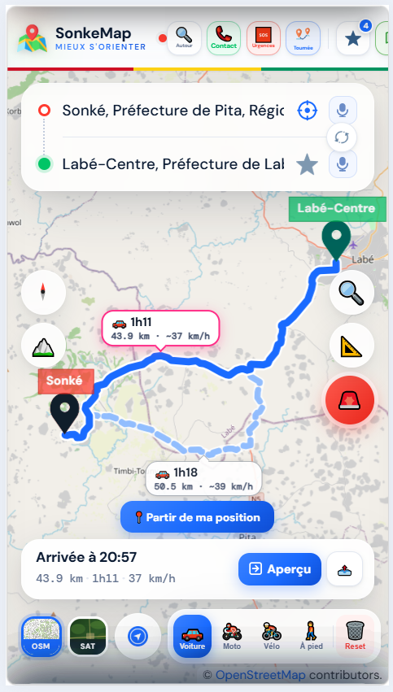
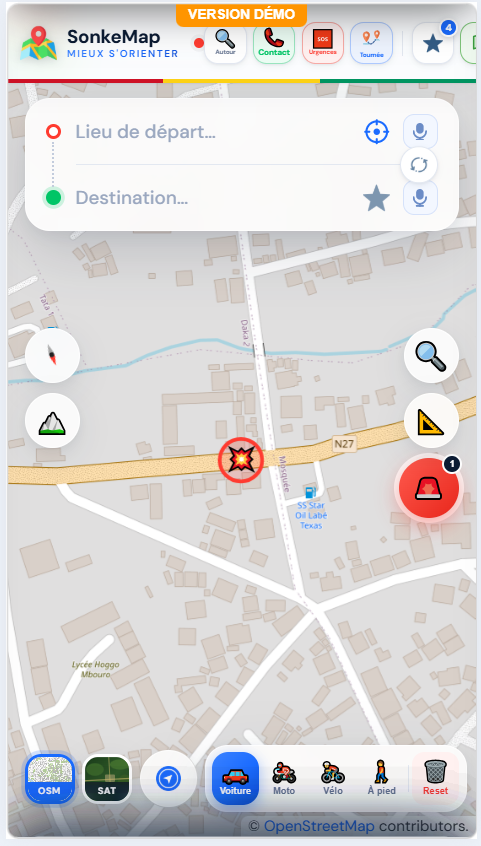
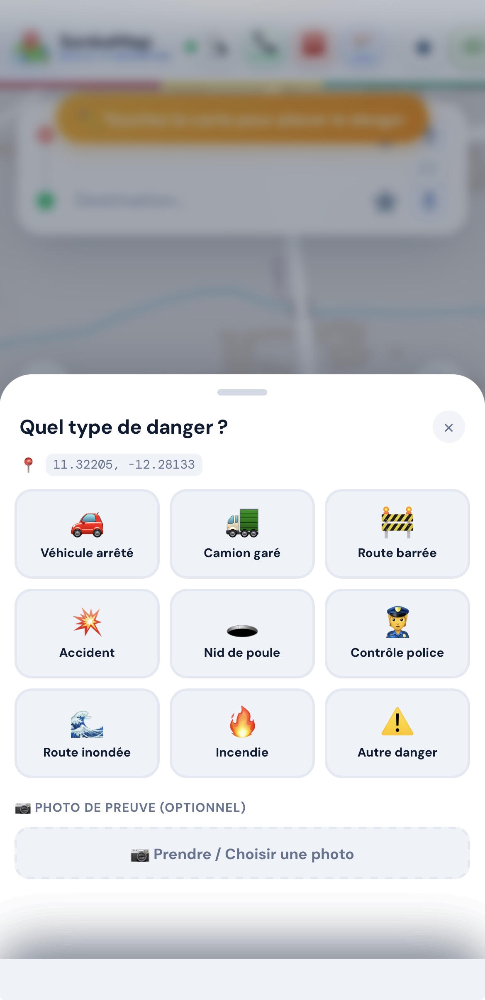

# SonkeMap

**Application web de navigation pour la Guinée** : itinéraires, guidage vocal, signalement des dangers sur la route et numéros d'urgence, dans une application installable sur téléphone (PWA).

🔗 **Démo en ligne : [mamadouba0228.github.io/sonkemap](https://mamadouba0228.github.io/sonkemap/)**
&nbsp;·&nbsp; version de test : [/demo](https://mamadouba0228.github.io/sonkemap/demo/)

> *English summary: SonkeMap is a mobile-first navigation web app for Guinea (West Africa): turn-by-turn routing with French voice guidance, community hazard reporting, multi-stop route optimisation and emergency contacts. Built with vanilla JavaScript, OpenLayers, OpenRouteService and a small PHP backend; installable as a PWA.*

---

## Aperçu

<table>
  <tr>
    <td align="center"><br><sub>Itinéraire avec alternative</sub></td>
    <td align="center"><br><sub>Accident signalé par un usager</sub></td>
    <td align="center"><br><sub>Choix du type de danger</sub></td>
  </tr>
</table>

## Pourquoi

En Guinée, les applications de navigation grand public couvrent mal le réseau local : pistes, routes inondées pendant la saison des pluies, contrôles, véhicules en panne sur la chaussée… SonkeMap s'appuie sur les données ouvertes d'OpenStreetMap et sur les signalements des usagers pour proposer un outil adapté au terrain, utilisable sur des téléphones d'entrée de gamme et avec une connexion faible.

## Fonctionnalités

**Itinéraires et navigation**
- Calcul d'itinéraire en voiture, moto, vélo ou à pied, avec itinéraires alternatifs
- Navigation guidée avec **annonces vocales en français**, suivi GPS et écran maintenu allumé
- Recherche d'adresse, saisie vocale, départ depuis la position GPS
- **Tournée multi-arrêts** : ordre de passage optimisé (plus proche voisin puis amélioration 2-opt)
- Favoris et historique des trajets

**Sécurité routière**
- **Signalement de dangers** : accident, route barrée, route inondée, nid de poule, contrôle, véhicule arrêté… avec photo
- Liste et carte des dangers signalés, partage par lien
- Bouton **Urgences** : SAMU, police, pompiers, en un appel

**Carte**
- Fonds de plan OpenStreetMap, satellite et hybride (imagerie Esri, jusqu'à ~30 cm en ville)
- Points d'intérêt autour de soi : stations-service, hôpitaux, mosquées, restaurants
- Outils de mesure de distance et de surface, altitude et météo du point choisi
- Partage d'un itinéraire ou de sa position par WhatsApp

**Application**
- **PWA** installable sur Android et iPhone, bannière hors-ligne
- Interface pensée d'abord pour le mobile (écrans de 360 px), adaptée à l'ordinateur

## Technique

| Côté | Outils |
|---|---|
| Interface | HTML, CSS, JavaScript, [OpenLayers 10](https://openlayers.org/), jQuery |
| Itinéraires | [OpenRouteService](https://openrouteservice.org/) via un proxy PHP (la clé d'API reste côté serveur) |
| Données | OpenStreetMap, Nominatim (géocodage), Overpass (points d'intérêt), Open-Meteo (météo, altitude) |
| Serveur | PHP sur Alwaysdata : proxy ORS, API des dangers, CORS et limitation de débit |
| Navigateur | Web Speech API (voix), Geolocation, Wake Lock, Service Worker |
| Publication | GitHub Actions → GitHub Pages, deux canaux : `main` → démo, `stable` → production |

**Quelques problèmes résolus**
- *Imagerie satellite incomplète* : en Guinée, Esri n'a pas la même précision partout (zoom 19 à Conakry, 17 à Labé). La carte demande la meilleure précision et retombe sur le niveau inférieur là où l'image manque, au lieu d'afficher une tuile vide. Sur les écrans haute définition, elle charge un niveau plus détaillé pour rester nette.
- *Clé d'API protégée* : aucune clé dans le navigateur, tout passe par un proxy PHP qui filtre les origines et limite le nombre de requêtes.
- *Tournée multi-arrêts* : heuristique du plus proche voisin, puis optimisation 2-opt pour raccourcir le trajet.

## Structure du projet

```
calcul_itineraire/   Application actuelle (page unique) + API PHP
public/, server/     Nouvelle architecture modulaire (modules ES), en cours de migration
scripts/             Construction du site pour GitHub Pages
docs/                Architecture et plan de migration
```

Le code de l'application tient aujourd'hui dans une page unique, issue du prototype. Sa migration vers une architecture modulaire (services, fonctionnalités, état partagé) est en cours : voir [docs/ARCHITECTURE.md](docs/ARCHITECTURE.md).

## Lancer en local

```bash
cp calcul_itineraire/ors_proxy.example.php calcul_itineraire/ors_proxy.php   # puis renseigner la clé OpenRouteService
php -S localhost:8000
# ouvrir http://localhost:8000/calcul_itineraire/SonkeMap.html
```

Une clé OpenRouteService gratuite s'obtient sur [openrouteservice.org](https://openrouteservice.org/dev/#/signup).

## Sources des données

Données cartographiques © [contributeurs OpenStreetMap](https://www.openstreetmap.org/copyright) (ODbL) · Imagerie © Esri, Vantor, Earthstar Geographics · Itinéraires © OpenRouteService · Météo et altitude : Open-Meteo

## Auteur

**Mamadou Ba** · [GitHub](https://github.com/mamadouba0228)

## Licence

[MIT](LICENSE)
